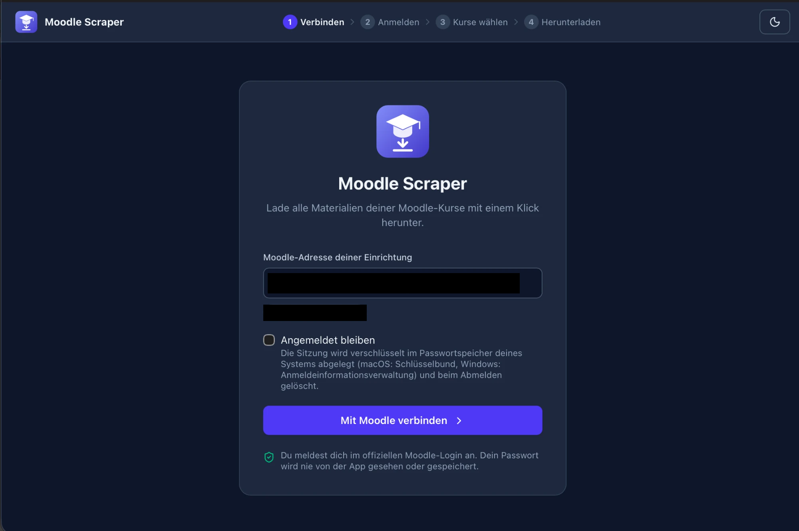
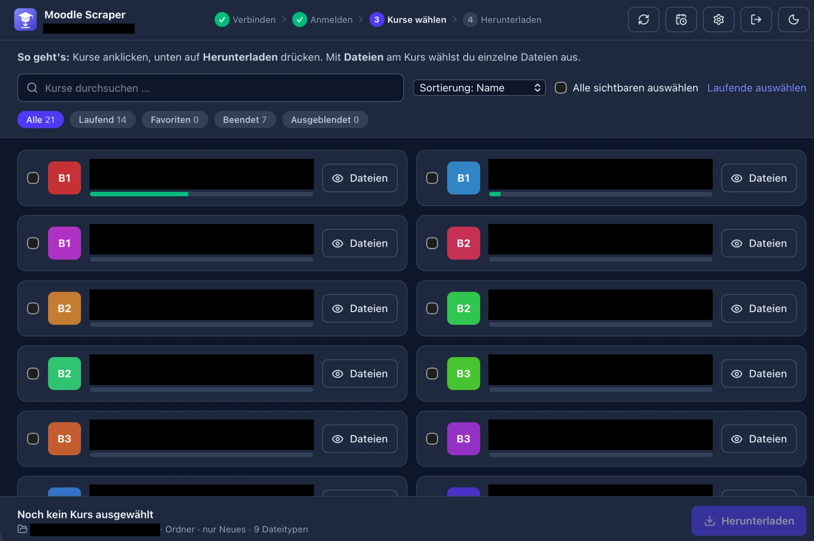
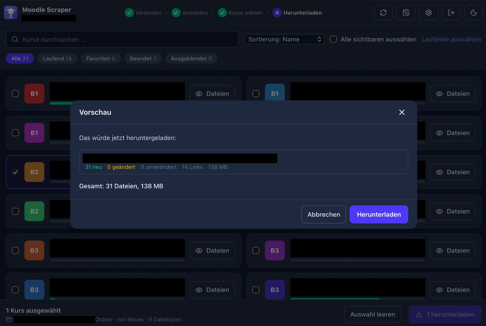
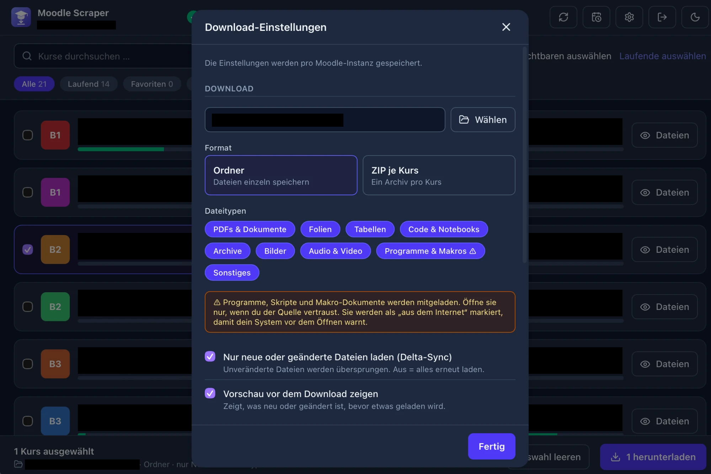
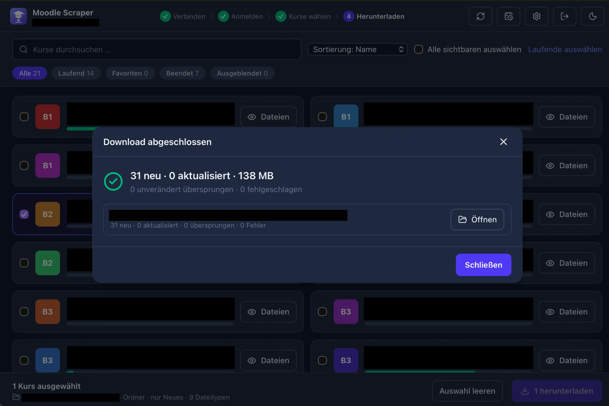
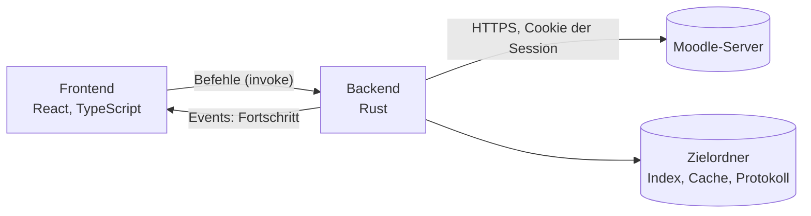

# Moodle Scraper

[](https://github.com/MHabachia/moodle-scraper/actions/workflows/tests.yml)
[](https://github.com/MHabachia/moodle-scraper/actions/workflows/build.yml)
[](https://github.com/MHabachia/moodle-scraper/releases/latest)
[](#installation)
[](LICENSE)

Ein Desktop-Programm für macOS und Windows, das die Dateien aller deiner Moodle-Kurse auf einmal herunterlädt. Du meldest dich wie gewohnt bei deiner Uni-Moodle an, wählst die Kurse aus und bekommst die Materialien als Ordner oder als ZIP pro Kurs. Beim nächsten Mal lädt die App nur das, was neu ist.

Es braucht weder einen API-Token noch Admin-Rechte. Die App benutzt dieselben Seiten wie dein Browser.

## Was die App kann

- Anmeldung im normalen Moodle-Fenster, auch mit Uni-SSO und Zwei-Faktor. Das Passwort sieht die App nie.
- Kursliste mit Suche, Filtern (laufend, Favoriten, beendet, ausgeblendet) und Mehrfachauswahl.
- Lädt Dateien, Ordner mit Unterordnern, Aufgaben-Anhänge und eingebettete Dateien. Externe Links (etwa Vorlesungsvideos) landen in einer `Links.md` pro Kurs.
- Vorschau vor dem Download: was ist neu, was geändert, was unverändert.
- Delta-Sync: Unveränderte Dateien werden übersprungen.
- Mehrere Downloads parallel, mit Wiederholungen bei Fehlern. Läuft die Anmeldung mitten im Download ab, kannst du dich neu anmelden und genau dort weitermachen.
- Fristen und Termine aus dem Moodle-Kalender, exportierbar als `.ics`.
- Optional: angemeldet bleiben (Passwortspeicher des Systems), im Tray weiterlaufen, automatisch synchronisieren.
- Oberfläche auf Deutsch und Englisch, helles und dunkles Design.

## Installation

Die fertigen Installer gibt es unter [Releases](../../releases):

| System | Datei |
|---|---|
| macOS (Apple Silicon und Intel) | `.dmg` |
| Windows 10/11 | `-setup.exe` (Installation nur für den eigenen Benutzer) |

Die Programme sind nicht mit einem bezahlten Entwicklerzertifikat signiert, deshalb warnt das System beim ersten Start:

- **macOS:** App nach `/Applications` ziehen und öffnen. Kommt die Meldung, dass der Entwickler nicht überprüft werden kann, die Meldung schließen und unter *Systemeinstellungen → Datenschutz & Sicherheit* auf „Trotzdem öffnen“ klicken. Auf älteren macOS-Versionen reicht Rechtsklick und „Öffnen“. Die App ist ad-hoc signiert, ein Terminal-Befehl ist nicht nötig.
- **Windows:** In der SmartScreen-Meldung auf „Weitere Informationen“ und „Trotzdem ausführen“ klicken.

Zu jedem Release gehört eine `SHA256SUMS.txt`, mit der du den Download prüfen kannst:

```bash
shasum -a 256 Moodle.Scraper_*_universal.dmg      # macOS
Get-FileHash .\Moodle.Scraper_*_x64-setup.exe     # Windows (PowerShell)
```

## So benutzt du sie

1. Moodle-Adresse eingeben, zum Beispiel `moodle.meine-uni.de`.
2. Im geöffneten Fenster anmelden. Sobald es klappt, geht die App von selbst weiter.
3. Kurse anklicken. Mit „Dateien“ kannst du einzelne Dateien eines Kurses abwählen.
4. „Herunterladen“ drücken, die Vorschau prüfen und bestätigen.
5. Das Ergebnis öffnest du direkt aus dem Abschlussdialog.

Die Einstellungen (Zielordner, Ordner oder ZIP, Dateitypen und mehr) gelten pro Moodle-Instanz.

<p align="center">
  
</p>

<p align="center">
  
</p>

<p align="center">
  
  
</p>

<p align="center">
  
</p>

*Von oben: Startbildschirm, Kursliste, darunter links die Vorschau vor dem Download und rechts die Einstellungen, zuletzt die Zusammenfassung nach dem Download. Kursnamen und Hochschule sind in den Bildern geschwärzt.*

## Technik

| Schicht | Technik |
|---|---|
| App-Rahmen | [Tauri 2](https://tauri.app) (Rust-Kern mit Webview, ohne eingebauten Browser) |
| Backend | Rust: `reqwest` (HTTP, Cookies), `scraper` (HTML), `tokio` (async), `zip`, `keyring`, `fs4` |
| Frontend | React 19, TypeScript, Vite, Tailwind CSS 4, lucide-react |
| Updates | `tauri-plugin-updater`: signierte Pakete, `latest.json` im neuesten GitHub-Release |
| Schnittstelle | Tauri-Befehle und Events; die TypeScript-Typen erzeugt `ts-rs` aus den Rust-Typen |
| Tests | `cargo test` (Unit-, Integrations- und Ende-zu-Ende-Tests gegen ein nachgebautes Moodle), Vitest mit Testing Library |
| CI/CD | GitHub Actions: `tests.yml` (Typen, Frontend- und Rust-Tests) und `build.yml` (Installer für macOS und Windows) |

## Wie die App aufgebaut ist

Die App besteht aus zwei Teilen, die nur über Tauri-Befehle miteinander reden:



- Das **Frontend** hält nur den Zustand der Oberfläche (Auswahl, Dialoge, Einstellungen) und steuert den Ablauf.
- Das **Backend** meldet sich über ein echtes Moodle-Fenster an, übernimmt dessen Cookies, liest Kursstruktur und Dateien aus und lädt sie herunter. Alles Netzwerk- und Dateisystem-Zeug passiert dort.

Der Ablauf im Einzelnen, die Module und die Entscheidungen dahinter stehen in [docs/architektur.md](docs/architektur.md).

## Projektstruktur

```
src/                        Frontend
  App.tsx, AppView.tsx      Wurzel (Session, Einstellungen, Sprache) und Ablauf
  components/               Bildschirme und Dialoge
  hooks/                    useSettings, useDownload, useAutoSync
  i18n/                     Deutsch und Englisch
  lib/                      Filter, Sortierung, Aufbau des Download-Auftrags
  generated/                TypeScript-Typen aus Rust (von ts-rs, nicht von Hand ändern)
  api.ts, utils.ts, ui.tsx, notify.ts

src-tauri/                  Backend
  src/main.rs               Start, Befehle, Fenster- und Tray-Verhalten
  src/session.rs            Anmeldung, Cookie-Jar, Keep-Alive, Kursliste
  src/scan.rs               Kurs scannen: Struktur und Dateien auflösen
  src/scan_cache.rs         Cache der Kursstruktur auf der Platte
  src/download/             Download, Delta-Sync, Vorschau, Links.md, ZIP
  src/parse/                Parser für Moodle-Seiten
  src/util/                 Pfade, URLs, Geheimnisse, Zeit, Kalenderexport
  src/deadlines.rs, secure.rs, tray.rs, diagnostics.rs, log.rs
  src/testutil.rs           Testserver und Fake-Moodle
  tests/fixtures/           HTML-Beispiele verschiedener Moodle-Versionen
  capabilities/, tauri.conf.json

docs/architektur.md         Aufbau im Detail
.github/workflows/          tests.yml, build.yml
.github/ISSUE_TEMPLATE/     Vorlagen für Fehlermeldungen und Wünsche
CONTRIBUTING.md, SECURITY.md, CHANGELOG.md, LICENSE
```

## Entwickeln

Voraussetzungen: Node 22.12 oder neuer, Rust (stable). Unter Windows wird WebView2 gebraucht, das in Windows 11 schon dabei ist.

```bash
npm install
npm run tauri dev       # Entwicklungsmodus
npm run tauri build     # Installer für das aktuelle System
```

Tests und Prüfungen:

```bash
npm run lint                                              # TypeScript
npm test                                                  # Frontend
npm run build && cargo test --manifest-path src-tauri/Cargo.toml   # Backend
cargo fmt --manifest-path src-tauri/Cargo.toml --check
cargo clippy --manifest-path src-tauri/Cargo.toml --all-targets -- -D warnings
```

`cargo test` braucht vorher `npm run build`, weil Tauri das gebaute Frontend einbindet. Außerdem schreibt der Testlauf die TypeScript-Typen nach `src/generated/`; die CI prüft, dass sie zum Rust-Code passen.

**Release:** Version in `package.json`, `src-tauri/Cargo.toml` und `src-tauri/tauri.conf.json` anheben, den Eintrag im `CHANGELOG.md` ergänzen und einen Tag `vX.Y.Z` pushen. Der Workflow `build.yml` startet bei dem Tag, lässt zuerst `tests.yml` laufen, baut dann macOS und Windows, veröffentlicht das Release mit den Installern und der `SHA256SUMS.txt`. Dazu kommen `latest.json` und das macOS-Update-Paket, die nur die Update-Funktion der App braucht. Sie werden mit dem Schlüssel aus dem GitHub-Secret `TAURI_SIGNING_PRIVATE_KEY` signiert; der öffentliche Schlüssel steht in `tauri.conf.json`.

## Sicherheit

Die wichtigsten Punkte, Details in [SECURITY.md](SECURITY.md):

- Verbindungen laufen nur über https. Das Session-Cookie geht ausschließlich an den Moodle-Host.
- Die App ruft nur Adressen der verbundenen Moodle-Instanz ab, nie externe Seiten.
- Programme und Makro-Dokumente werden nur geladen, wenn du das einschaltest, und dann als „aus dem Internet“ markiert.
- Dateinamen und Zielordner werden geprüft, damit nichts außerhalb des Zielordners landet.
- „Angemeldet bleiben“ ist aus, solange du es nicht einschaltest.

## Grenzen

- Moodle-Themes und -Versionen unterscheiden sich. Bei ungewöhnlichen Kursseiten kann etwas fehlen. Hilfreich ist dann ein anonymisiertes HTML der Kursseite als Issue.
- Nicht unterstützt: Seiten, Bücher, Forenanhänge, eingebettete Videoplayer.
- Fehlermeldungen aus dem Backend gibt es nur auf Deutsch, die Oberfläche ist zweisprachig.
- Auto-Sync läuft nur, solange die App läuft (auch im Tray) und angemeldet ist.
- Updates: Die App sucht beim Start nach einer neuen Version (abschaltbar) und installiert sie nach deiner Bestätigung. Die Update-Pakete sind signiert, die Installer selbst nicht.

## Hinweise zur Nutzung

- Die Nutzung geschieht auf eigene Verantwortung. Die App wird ohne Gewähr bereitgestellt (siehe [Lizenz](LICENSE)).
- Prüfe vorher die Nutzungsbedingungen deiner Hochschule. Das Herunterladen deiner eigenen Kursmaterialien ist meist unproblematisch, aber nicht überall erlaubt. Lade nur Inhalte, auf die du Zugriff hast, und gib sie nicht ohne Erlaubnis weiter.
- Die App sendet nur so viele Anfragen wie nötig und drosselt sich bei Überlastung des Servers. Stelle die Zahl der parallelen Downloads bei Bedarf niedriger ein.
- Das ist ein inoffizielles Projekt. Es steht in keiner Verbindung zu Moodle Pty Ltd oder zu deiner Hochschule. „Moodle“ ist eine Marke von Moodle Pty Ltd.

## Mitmachen

Fehler und Wünsche gern als [Issue](../../issues). Wie man das Projekt baut und Änderungen einreicht, steht in [CONTRIBUTING.md](CONTRIBUTING.md).

## Lizenz

[MIT](LICENSE)
